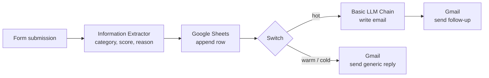

# N8N-Lead-Capture[README (1).md](https://github.com/user-attachments/files/35057611/README.1.md)
# AI Lead Capture and Follow-up (n8n)

An n8n workflow that captures leads from a web form, uses an AI model to score them, logs every lead to Google Sheets, and sends hot leads a personalized follow-up email within seconds. Warm and cold leads get a short, generic thank-you.


## What it does

1. A lead fills out a form (name, email, company, and a free-text "What do you want?").
2. An **Information Extractor** (Google Gemini) classifies the lead as `hot`, `warm`, or `cold`, gives it a score from 1 to 10, and writes a one-sentence reason.
3. The lead and the AI's verdict are appended to a **Google Sheet**, so every submission is logged.
4. A **Switch** routes the lead:
   - **Hot:** an LLM chain writes a friendly 4-sentence email that references the lead's company and request and offers a 15-minute call. Gmail sends it.
   - **Warm or cold:** Gmail sends a short generic reply.



## Tech stack

- [n8n](https://n8n.io) (self-hosted or cloud)
- Google Gemini (chat model for classification and email writing)
- Google Sheets (lead log)
- Gmail (email sending)

## Setup

### 1. Create the Google Sheet

Create a sheet with these exact headers in row 1 (no trailing spaces):

```
Timestamp | Name | Email | Company | Need | Category | Score | Reason
```

### 2. Import the workflow

1. In n8n, create a new workflow.
2. Open the menu (top right) and choose **Import from file**, then select `workflow/lead-capture.json`.

### 3. Add credentials

n8n will flag the nodes that need them:

| Node | Credential |
| --- | --- |
| Google Gemini Chat Model (x2) | Google Gemini (PaLM) API key from [Google AI Studio](https://aistudio.google.com) |
| Append row in sheet | Google Sheets OAuth2 |
| Email (Hot lead), Email (Warm or Cold Lead) | Gmail OAuth2 |

### 4. Edit the placeholders

- **Append row in sheet:** select your spreadsheet and sheet (the file contains `YOUR_GOOGLE_SHEET_ID`).
- **Basic LLM Chain** and **Email (Warm or Cold Lead):** replace `[Your Name]` with your real name.

### 5. Test it

Open the **On form submission** node, click **Execute step**, and submit the test form. Use your own email address in the Email field so test emails come to you. Try these three:

| Test | What do you want? | Expected |
| --- | --- | --- |
| Hot | `We need a CRM for our 40 sales reps. Budget is approved, we want to start onboarding by early January, and I'd like a demo this week.` | Category `hot`, score 8-10, personalized email |
| Warm | `We might need some help managing our customers at some point. Can you send more information? No rush.` | Category `warm`, generic reply |
| Cold | `just looking around` | Category `cold`, generic reply |

### 6. Go live

Publish the workflow and share the form's **Production URL** (not the Test URL).

## Example output

A hot lead receives an email like this:


## Customizing

- **Scoring rules:** edit the system prompt in the Information Extractor. For example, require a stated budget or deadline for `hot`.
- **Email tone and length:** edit the prompt in the Basic LLM Chain.
- **Separate warm and cold:** add a second rule to the Switch (`Category` equals `warm`) and wire it to its own email.
- **Different form tool:** replace the Form Trigger with a Webhook or Tally Trigger. Then update the expressions that read `$('On form submission')` (in the Information Extractor, and the Name, Email, Company and Need columns of the Sheets node). If n8n runs on `localhost`, third-party tools cannot reach it, so you need a public URL or tunnel such as Cloudflare Tunnel.

## Known limitations

- The Gemini free tier has low per-minute limits. Submitting many leads at once can return a "too many requests" error. Turn off retries or use a paid key for higher traffic.
- Gmail has daily sending limits.
- A public form can attract spam. Add a captcha or honeypot field before sharing it widely.
- The AI's classification is a judgment call. Check the `Reason` column when a result looks off and tune the prompt.

## Project structure

```
.
├── README.md
├── workflow/
│   └── lead-capture.json
└── screenshots/
    ├── 01-workflow-hot-lead.png
    ├── 02-workflow-warm-cold-lead.png
    └── 03-hot-lead-email.png
```

## License

MIT
